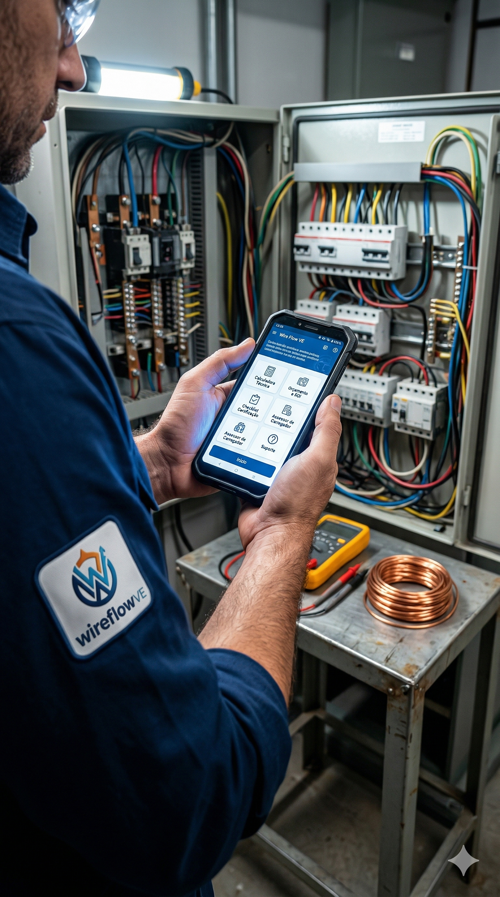
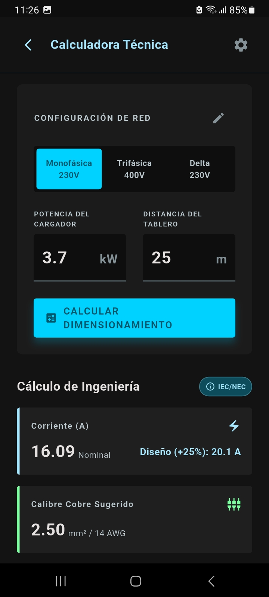
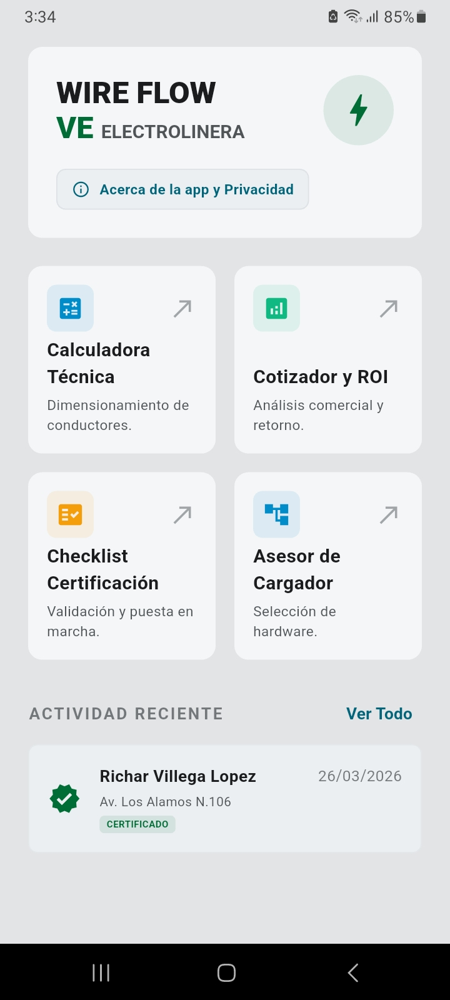
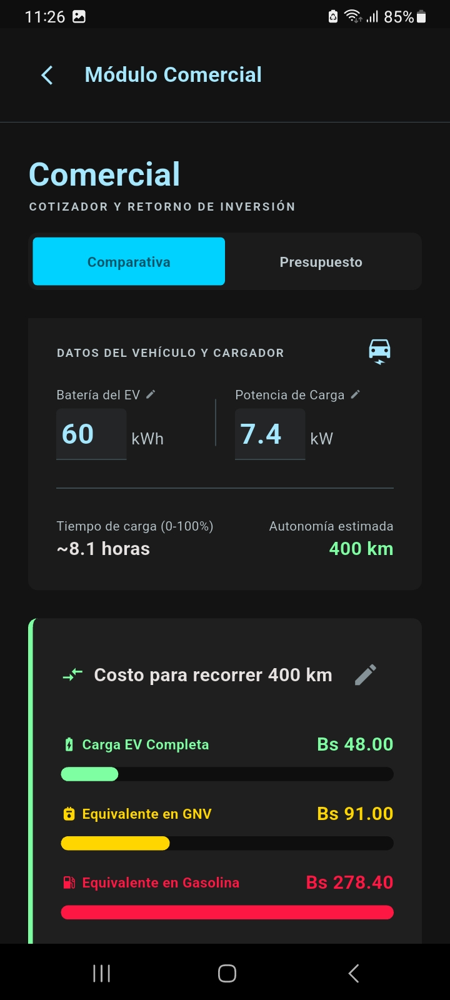

# WireFlow VE — Ingeniería, Cotización y Certificación de Electromovilidad en Bolivia


WireFlow VE es una aplicación móvil offline-first orientada a instaladores electricistas, contratistas e ingenieros para el dimensionamiento de conductores, evaluación de retorno de inversión frente a combustibles fósiles, selección técnica de hardware de recarga y certificación formal de estaciones de carga para vehículos eléctricos bajo normativa boliviana.

---

## Módulos y Capacidades Principales

### 1. Calculadora Técnica de Ingeniería Eléctrica
* **Soporte Integral de Redes de Distribución en Bolivia:**
  * Monofásica estándar (220 V entre Fase y Neutro).
  * Trifásica industrial/comercial (380 V entre fases, 220 V con neutro).
  * Red Delta 220 V (bifásica fase-fase sin neutro, frecuente en áreas tradicionales de La Paz, Cochabamba y distritos industriales).
* **Verificación de Caída de Tensión Admisible:**
  * Cumplimiento estricto de la Norma Boliviana **NB 777** ($\Delta V \le 3\%$).
  * Detección preventiva de distancias críticas que excedan el límite reglamentario.
* **Sobrecarga Continua del 125%:** Dimensionamiento de corriente nominal considerando régimen de servicio continuo propio de la carga de vehículos eléctricos.
* **Protecciones Eléctricas en Cascada:**
  * Selección y especificación con nomenclatura técnica y comercial (Disyuntores Bipolares y Tetrapolares Curva C).
  * Calibre de interruptores diferenciales (RCD Tipo A de 30 mA) y descargadores de sobretensiones transitorias (SPD Clase II).

### 2. Módulo Comercial, Presupuesto y Retorno de Inversión (ROI)
* **Cotizador Modular con Precios Locales:**
  * Desglose de materiales y protecciones homologadas con precios calibrados en moneda nacional (Bolivianos - Bs).
  * Incluye gabinete estanco IP65, interruptor diferencial Tipo A de 30 mA, SPD Clase II, protector contra sobre/subtensión (OVP/UVP), accesorios de canalización y kit de puesta a tierra.
* **Cálculo Automático de Retorno de Inversión (Payback):**
  * Estimación dinámica del tiempo de amortización (en meses) contrastando el costo total presupuestado contra el ahorro mensual neto derivado de sustituir gasolina por energía eléctrica.
* **Comparativa de Costo Operativo por Kilómetro:**
  * Análisis de costo por km entre tarifa eléctrica domiciliaria, Gas Natural Vehicular (GNV) y gasolina especial/premium.
* **Exportación y Distribución Inmediata en PDF:**
  * Generación de presupuestos comerciales ejecutivos con validez formal y condiciones de garantía técnica.
  * Envío instantáneo por WhatsApp y correo electrónico mediante `Printing.sharePdf`.

### 3. Checklist y Certificación Técnica (Puesta en Marcha)
* **Homologación Regulatoria Nacional:**
  * Protocolo de inspección en obra alineado a la **Resolución Regulatoria AETN Nº 479/2021** (Autoridad de Fiscalización de Electricidad y Tecnología Nuclear) y la **NB 777**.
* **Puntos de Verificación en Campo:**
  * Altura de montaje reglamentaria (0.60 m a 1.30 m sobre nivel de piso terminado).
  * Grado de estanqueidad de envolventes (IP54 para intemperie, IP44 en recintos cubiertos).
  * Canalización protegida mecánica contra impactos y compatibilidad de esquemas de tierra (TN-S y TT).
* **Medición de Resistencia de Puesta a Tierra:**
  * Comprobación de valor con telurómetro ($\le 25\ \Omega$, umbral óptimo $< 10\ \Omega$).
  * Soporte para certificación directa in situ o delegación documentada a especialista externo.
* **Persistencia Profesional:** Almacenamiento local del nombre del técnico responsable y matrícula/registro del Colegio de Ingenieros de Bolivia (SIB).
* **Acta de Entrega Oficial en PDF:** Generación del documento formal de puesta en marcha listo para firma y archivo del cliente.

### 4. Asesor de Hardware y Cargadores VE
* **Carrusel Comparativo de Alternativas Técnicas:**
  * **Básica / Económica:** Cargador Portátil Reforzado (2.3 kW a 3.3 kW) en Schuko o CEE industrial.
  * **Estándar / Confort:** Wallbox Residencial Dedicado (7.0 kW a 7.4 kW) con circuito exclusivo de 32 A.
  * **Avanzada / Trifásica:** Wallbox Trifásico (11 kW a 22 kW) para redes 380 V.
* **Catálogo de Modelos del Mercado Boliviano:**
  * Presets verificados para vehículos de alta circulación: BYD (Dolphin Mini, Dolphin, Yuan Plus, Song Plus, Han/Tang), Quantum Motors (E2, E3, E4), Toyota (bZ4X, bZ3), Changan Lumin, Dongfeng Nano Box, JAC e-JS1 y Tesla/Euro EV.
  * Modo Personalizado / Ingreso Manual para vehículos no catalogados.
* **Detección de Límite del Cargador de a Bordo (OBC):** Advertencias técnicas preventivas cuando la potencia del cargador supera la capacidad de recepción en corriente alterna del automóvil.
* **Alertas de Acometida Residencial:** Notificación para asegurar disyuntor general en medidor $\ge 40\text{ A}$ ante consumos continuos de 32 A.
* **Interoperabilidad Directa:** Botones de acción contextual que transfieren automáticamente la potencia calculada y la capacidad de batería hacia la Calculadora Técnica y el Cotizador Comercial.

---

## Especificaciones Técnicas y Arquitectura

* **Framework:** Flutter con Material Design 3.
* **Arquitectura de Interfaz:** Diseño adaptativo para smartphones y tablets (limitación de ancho máximo a 720 dp en pantallas grandes, selectores táctiles mediante BottomSheets nativos).
* **Persistencia Local:** Drift (ORM tipado sobre base de datos SQLite) con arquitectura estricta 100% offline-first. Los datos de cotizaciones, clientes e inspecciones residen exclusivamente en el dispositivo.
* **Preferencias:** `shared_preferences` para memorizar datos de matrícula del técnico instalador.
* **Generación Documental:** Motores vectoriales `pdf` y `printing` para emisión de actas y cotizaciones en formato A4 estándar.

---

## Capturas de Pantalla

| Guía de Conectores | Calculadora Técnica | Dashboard de Inicio | Módulo Comparativo |
| :---: | :---: | :---: | :---: |
|  |  |  |  |

---

## Instalación y Ejecución

### Prerrequisitos
* [Flutter SDK](https://docs.flutter.dev/get-started/install) (versión 3.8.1 o superior).
* Android Studio / Xcode configurados para emulación o despliegue en dispositivo físico.

### Pasos de Configuración
1. Clonar el repositorio:
   ```bash
   git clone https://github.com/ElTapiaGit/Wire-Flow-VE-electrolineras.git
   cd Wire-Flow-VE-electrolineras
   ```

2. Obtener las dependencias del proyecto:
   ```bash
   flutter pub get
   ```

3. Ejecutar las pruebas unitarias:
   ```bash
   flutter test
   ```

4. Ejecutar el análisis de código estático:
   ```bash
   flutter analyze
   ```

5. Iniciar la aplicación en modo desarrollo:
   ```bash
   flutter run
   ```

---

## Marco Normativo de Referencia
* **NB 777:** Norma Boliviana para Diseño y Construcción de Instalaciones Eléctricas en Baja Tensión.
* **Resolución Regulatoria AETN Nº 479/2021:** Requisitos y Condiciones Técnicas para la Infraestructura de Carga de Vehículos Eléctricos en Bolivia.
* **IEC 61851 / IEC 62196:** Sistemas de Carga Conductiva para Vehículos Eléctricos.
